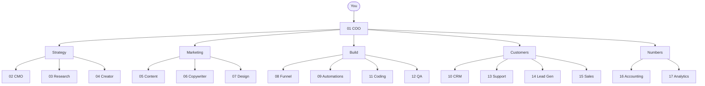

# The 17 agents

Each card below is one AI employee: its job, its tasks, when it works, what it hands over, how you know it's working and which tools it needs. You talk to the COO, and the COO hands work to the rest.

Every card fits in under 8,000 characters, so you can paste it into a chat app's instructions box. In Claude Code, setup turns each card you approve into a subagent in `.claude/agents/`.



## The team

| # | Agent | Job | Default cadence | Works best connected to |
|---|---|---|---|---|
| 01 | [COO](01-coo.md) | Builds your AI team and hands work to the other agents | Daily and weekly briefs | [CALENDAR] |
| 02 | [CMO](02-cmo.md) | Organizes your brand context and decides what the business needs next | Monthly plan | [ANALYTICS] |
| 03 | [Research](03-research.md) | Researches your industry for data, news and ideas | Weekly digest | Web search |
| 04 | [Creator](04-creator.md) | Watches other creators and founders in your space | Weekly report | Web search, [CHANNELS] |
| 05 | [Content](05-content.md) | Finds outlier videos and posts that already do well and plans yours | Weekly plan | [CHANNELS] |
| 06 | [Copywriter](06-copywriter.md) | Writes direct response sales copy in your voice | When asked | [STORAGE] |
| 07 | [Design](07-design.md) | Designs your brand guide, graphics, pages and content | When asked | [DESIGN TOOL] |
| 08 | [Funnel](08-funnel.md) | Plans and builds the whole funnel, start to finish | Per project | [FUNNEL SOFTWARE] |
| 09 | [Automations](09-automations.md) | Builds the workflows and integrations in your software | Per project | [CRM], [EMAIL TOOL] |
| 10 | [CRM](10-crm.md) | Organizes your leads, customers and clients | Weekly cleanup | [CRM] |
| 11 | [Coding](11-coding.md) | Builds your apps and tools start to finish and publishes them | Per project | [CODE HOST], [HOSTING] |
| 12 | [QA](12-qa.md) | Tests every project and gives detailed feedback before launch | Before every launch | A browser |
| 13 | [Support](13-support.md) | Checks your inboxes every day and drafts replies | Daily | [INBOX] |
| 14 | [Lead Gen](14-lead-gen.md) | Finds leads and their public contact details in any niche | Weekly list | Web search, [CRM] |
| 15 | [Sales](15-sales.md) | Finds the leads most likely to buy now and drafts the next message | Daily hot list | [CRM], [INBOX] |
| 16 | [Accounting](16-accounting.md) | Files every receipt and invoice from your email in one folder | Daily | [INBOX], [STORAGE] |
| 17 | [Analytics](17-analytics.md) | Tracks your content, sales and profit and reports to you | Weekly scorecard | [ANALYTICS], [PAYMENTS] |

You don't need all 17. Start with 4 to 6 from [setup/starter-teams.md](../setup/starter-teams.md) and add an agent when a real bottleneck shows up.

## The five parts of every setup

Setup asks 2 or 3 questions per agent and saves your answers in `my-business/team/<agent>.md`. The card stays the same for everyone. Your setup file makes the agent yours.

1. **Role:** the job in one sentence, for your business.
2. **Tasks:** the specific tasks you want from it, picked from the card.
3. **Cadence and deliverables:** when it works and what it hands over each time.
4. **Outcome:** the number or result that shows it's working.
5. **Connections:** the tools it can read or write, and with what access.

```
# [AGENT] setup
Level: Assistant   Installed: [YYYY-MM-DD]   Last upgrade: [YYYY-MM-DD]

Role: [THE JOB IN ONE SENTENCE, FOR THIS BUSINESS]
Tasks:
- [TASK]
Cadence and deliverables:
- [WHEN]: [DELIVERABLE], saved to [PATH]
Outcome: [THE NUMBER OR RESULT THAT SHOWS IT'S WORKING]
Connections:
- [TOOL]: [READ, DRAFT OR FULL], or not connected yet
Setup answers:
- [QUESTION]: [ANSWER]
Standing rules:
- None yet
Upgrades:
- [YYYY-MM-DD]: [WHAT CHANGED, AND WHICH RATINGS IT CAME FROM]
```

## Levels

Every agent starts as an Assistant. Only you move it up, and you can move it back down any time.

| Level | What the agent does | When the COO suggests it |
|---|---|---|
| Assistant | Works when asked. Everything it makes is a draft. | Every agent starts here |
| Employee | Works on its cadence without being asked. Still drafts, plus any actions you allowed in a standing rule. | About 10 approved outputs with no Blocker issues |
| Lead | Plans its own week toward its outcome, asks other agents for work through the COO and reports to you weekly. | A month at Employee, rated mostly 4 or 5 |

A standing rule is one line in the agent's setup file that pre-approves one kind of action, for example "Support may send the order-status reply without asking." Some things never go into a standing rule: paying or moving money, deleting data, sharing private data, and anything legal or medical. Those always wait for your yes.

## The weekly rhythm

The defaults. Each agent's setup file can change its own days.

| When | Agent | What you get |
|---|---|---|
| Every work day | COO | The daily brief, under 200 words |
| Every work day | Support | Reply drafts for new messages |
| Every work day | Sales | The hot list and the next message for each lead |
| Every work day | Accounting | New receipts and invoices filed, with flags |
| Monday | Analytics | The weekly scorecard |
| Monday | COO | The weekly brief and the plan for the week |
| Monday | Lead Gen | This week's lead list |
| Wednesday | Creator | The watchlist report |
| Wednesday | QA | The live check of your main funnel |
| Thursday | Research | The industry digest |
| Friday | Content | Next week's content plan |
| Friday | CRM | The pipeline report and the cleanup list |
| First week of the month | CMO and Analytics | The monthly plan and the flywheel review |
| First work day of the month | Accounting | The month-end folder for your bookkeeper |
| When asked | Copywriter, Design, Funnel, Automations, Coding | Project work |

## How work moves between agents

Agents pass work with the handoff note in [brain/CORE.md](../brain/CORE.md). The four chains you'll use most:

- **A new offer:** CMO shapes the offer, Research checks demand and the customer's words, Funnel maps the pages, Copywriter writes them, Design lays them out, Automations builds the follow-up, QA tests it all, and you approve the launch.
- **Weekly content:** Creator and Research feed ideas, Content picks the outliers and plans the week, Copywriter writes the scripts, Design makes the thumbnails, you record and publish, and Analytics reports what worked.
- **Clients:** Lead Gen finds the leads, the Copywriter and Sales draft the outreach, Sales works the replies, CRM keeps every stage current, and Support answers questions after the sale.
- **Back office:** Support passes receipts to Accounting, Accounting files them, Analytics reports the numbers, and the COO puts the decisions in your brief.

## Every card has the same parts

Job, Read first, Tasks, Cadence and deliverables, Outcome, Connect, Skills, How it works, Quality check, Taste, Handoffs, Autonomy and approvals, First task, Setup questions and Your setup. A finished example of each agent's work, for a fictional business, is in [examples/sample-business](../examples/sample-business/README.md).
